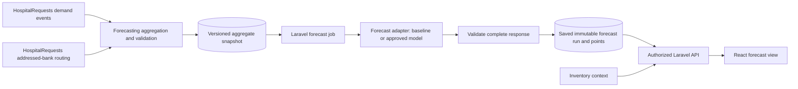

# AI integration plan: demand forecasting

Created: 26 October 2026. Reviewed against the current project files: 27 October 2026. Status: proposed design for FR-21 and FR-22; no forecasting service is implemented by this document.

## 1. Purpose and implementation boundary

Help bank administrators anticipate incoming requests by component and ABO/Rh group. Laravel's Forecasting module owns aggregation, generation jobs, authorization, saved results and provenance. React displays results. A replaceable forecasting adapter performs numerical prediction; begin with a local baseline and add a separately deployed model service only when justified by evaluation. No language model is required for numerical forecasting.

This plan follows [the functional requirements](BloodBank_Functional_Requirements.docx), the [English use cases](use-cases-specificaitons/use-case-specifications-en.docx) and their [Arabic counterpart](use-cases-specificaitons/use-case-specifications-ar.docx), with current field names from [the low-level ERD](ER/code/erd-low-level.mmd). FR-21 is a **Should** requirement and FR-22 a **Could** requirement for Graduation 1. Both assign forecasting work to bank administrators. All intervals, thresholds, endpoints and new fields below are proposed implementation defaults, not existing requirements or measured performance.

Repository inspection found no source files in the Forecasting, HospitalRequests and Inventory module directories. The architecture describes earlier scaffolding, but operational contracts and training data must be established before implementation can rely on them. The proposed ERD is a design reference, not evidence of deployed tables.

### Reconciliation with the current files

| Reviewed source | Finding and effect on this plan |
| --- | --- |
| [Low-level ERD](ER/code/erd-low-level.mmd), [high-level ERD image](ER/ERD-high-level.png) and [class design](Diagrams/Class/high-level-class-design.md) | The low-level schema has 14 entities and no `demand_forecasts` entity. The high-level view includes a Demand Forecasting capability. Forecast persistence is a schema gap, not an existing table to extend. |
| [Data dictionary](ER/docs/Blood%20Bank%20Platform%20ERD%20and%20Data%20Dictionary.docx) and [persistence review](ER/docs/erd-persistence-review.md) | These still describe the earlier 16-table design, including `demand_forecasts`. Its forecast fields are useful proposal material, but their presence here does not make them part of the current low-level ERD. |
| Requirements and bilingual use cases, FR-18–FR-22 | Match search precedes submission in the detailed use cases. No match creates no submitted request. Saved pending requests are addressed to a matched bank, while the ERD records only a later `accepted_bank_id`. FR-21 saves successful results; FR-22 retrieves them without recalculation or substitution. |
| [End-to-end flow](full-flow.tiff) and [use-case diagram](Diagrams/Use%20Case/Usecase.png) | The flow labels submission before matching and does not show a forecast branch; use-case text describes search before submission. The use-case diagram does include Forecast Demand. Its blanket inheritance of staff permissions by bank administrators must not be used to infer forecasting access to patient or specialist workflows. |
| [Literature review](Literature_Review.docx) | Describes request history as the demand signal and donation history as supply context. Its discussion of Kwon et al. uses transfusion-based research; those labels, data volumes and performance cannot be assumed for this request-based platform. It also proposes offline recording and later synchronization. |
| [Architecture](ARCHITECTURE.md) and [seminar plan](Seminar_1_Presentation_Plan.md) | Establish module boundaries and forecasting context, but retain references to older ERD paths or earlier workflow summaries. They do not resolve the newer request-attribution and persistence gaps. |

For forecast event semantics, this revision follows the more detailed bilingual use cases and explicitly records their conflict with the flow image. For actual field names, it follows the current low-level ERD. This is a planning choice pending reconciliation of those source documents, not a silent change to them. Only this forecasting plan is revised.

### Input and output in plain language

**Send:** bank identifier, component type, ABO/Rh group, a dated sequence of daily submitted-request quantities, the last complete synchronized date and the requested prediction period. The backend selects and aggregates the history. An administrator selects the bank scope, component, group and approved period; they do not type historical records into the AI interface.

**Receive:** predicted requested units for each future date, an estimated range when validated, the method used and any insufficient-data or freshness warning. For example, an illustrative result could say “Bank A, red cells, O+, 28 October: expected 12 units; p10–p90 range 8–17.” These numbers are examples, not calculated forecasts. Patient identity, requester contact, delivery address and donor medical records are not needed.

## 2. Forecast targets

| Decision | Proposed definition |
| --- | --- |
| Primary target | Total units in valid newly submitted hospital requests addressed to a bank per local calendar day. Predict the platform's recorded submitted demand, which is limited by matching before submission; do not claim total clinical need or all unmet demand. |
| Series key | Addressed bank at submission × component type × ABO group × Rh factor. Keep each exact group separate. |
| Time basis | Bucket by `submitted_at` in `Asia/Damascus`; retain timestamps in UTC. Record the timezone in each run. |
| Horizon | Seven local calendar dates starting today, using history through yesterday, for the initial release. The current day is predicted as a whole; this is not an estimate of only its remaining hours. Add 14/28-day horizons only after separate validation. |
| Frequency | Administrator-initiated generation under FR-21. Optional daily scheduling, initially 02:00 local time after yesterday's data is complete, is an extension rather than a required use-case step. |
| Prediction | Expected units and p10/p50/p90 predictive quantiles per day. Decimals are valid expectations; display rounding must not alter stored values. |
| User interpretation | Submitted demand likely to be addressed to this bank under the recorded matching workflow. Changes in available stock or routing may change this signal. It does not promise fulfillment or quantify unrecorded no-match needs. |

**Counting rule.** Count a valid saved request once at submission with its submitted quantity, whether later pending, accepted, manually rejected or automatically rejected for insufficient remaining stock under FR-20. Acceptance reserves units and does not prove physical delivery. The current use cases save no request for a no-match search or cancellation before submission; those events cannot be counted from `requests`. Exclude test entries, invalid submissions and confirmed duplicates using explicit links and reason codes. Preserve submission snapshots and correction history; do not infer duplicates from patient identity or count repeated matching searches as new demand. A later cancellation policy is not specified in the use cases; if added, define its target treatment before changing labels.

**Bank attribution is a prerequisite.** The current ERD has `accepted_bank_id`, which is nullable and identifies the bank only after acceptance. FR-18 and FR-20 require a pending request addressed to the matched bank before that decision. Propose `requests.addressed_bank_id` as a separate durable link captured when submission is revalidated. Keep `accepted_bank_id` for its existing meaning. Count submitted units against their original addressed bank, including subsequently rejected requests. The current use cases do not define rerouting; if introduced, preserve the original submission and record routing events without duplicating the demand event. Backfill old bank attribution only from reliable historical routing/notification evidence. Missing attribution blocks affected bank forecasts; do not infer it from a hospital's nearest bank today.

Until historical attribution is trustworthy, use a clearly named accepted-request workload analysis or an authorized network-level research report; do not publish either as a bank submitted-demand forecast. No fixed hospital-to-planning-bank mapping is required by the current workflow, so this revision removes that earlier proposal as a default dependency.

**Unobserved demand remains a limitation.** A zero-submission day can coexist with repeated no-match searches because insufficient stock prevents submission. State this limitation even when data capture is technically complete. If the project later needs a forecast including unmet needs, first approve and implement a separate deduplicated demand-intent event, with a stable identifier across Retry actions and an explicit bank/network attribution rule. Neither this event nor its target definition exists in the current ERD. Do not claim to forecast that broader target from submitted requests alone.

**Separate planning context.** Show known outstanding requests by `needed_by_at`, current released/available units, reservations and expiries alongside the forecast when those contracts exist. These are separate measures. Do not subtract current inventory from historical demand or add the same outstanding request to future request-arrival predictions. A forecast of new requests due on a future date, a supply forecast and an automated replenishment quantity are later targets requiring their own definitions and evaluation. FR-19 exact matching and atomic acceptance remain authoritative.

## 3. Required training data and readiness

| Data source / owner | Minimum fields | Use and required additions |
| --- | --- | --- |
| Requests / HospitalRequests | Stable request ID, hospital ID, proposed addressed-bank ID, component, ABO, Rh, submitted quantity, `submitted_at`, `needed_by_at`, status | Demand events. Add original submission snapshot, correction/duplicate links and event history with event and ingestion timestamps. Preserve manual and automatic rejection reasons. Mutable current status alone cannot reconstruct historical cutoffs. |
| Submission routing / HospitalRequests | Proposed `addressed_bank_id`, submission match timestamp, routing policy/version | Capture the bank addressed under FR-18 before acceptance. This is distinct from the existing optional accepting-bank field. |
| Collection completeness / operational ingestion owner | Organization, date, operating state, ingestion watermark, coverage status | New proposed records distinguish a true zero-request day from downtime, missing imports or pre-launch history. |
| Calendar / Forecasting | Local date, day of week, published holiday/event flags and source version | Future inputs must be known at the prediction cutoff. Calendar-only features are sufficient initially. |
| Inventory / Inventory | Component type/group, release/expiry timestamps, availability, reservation, issue and disposal events | Context and later simulation. Issue history is not the demand label. Historical snapshots are necessary before using stock as model features. |
| Donations / Donations | Bank, collection time/outcome, separation outcome, accepted component counts and release eligibility | Optional aggregated supply context from existing workflows. Failed collection/separation and uncleared components are not usable supply. Do not use donor-level screening data as demand inputs. |
| Synchronization / proposed offline support | Source organization, stable event ID, event time, server receipt time, last confirmed complete-through date, unresolved conflicts | The literature review proposes this capability but the current ERD does not model it. Define this contract before declaring offline-origin history complete. Deduplicate replayed events. |
| Model/run metadata / Forecasting | Dataset and feature versions, training window, cutoff, model artifact checksum, parameters, metrics | Reproducibility, rollback and audit. |

Training exports contain daily aggregates and opaque series identifiers. Patient references, names, donor details, contact information, credentials and clinical notes are unnecessary and must not enter model payloads or logs. Laravel retains the authorized mapping between opaque series keys and bank identities. Any shared model across banks requires explicit organization-level data access policy; until established, use bank-isolated training and adapters.

Proposed readiness gates:

1. Prefer 12–24 months of real history. The initial model eligibility minimum is 180 complete daily observations before the first evaluation origin, followed by at least 56 evaluation days. This supports testing weekly patterns; annual effects need longer history. Synthetic data can test contracts and demonstrations but cannot satisfy performance gates.
2. A baseline may operate with at least 56 complete daily observations if its own evaluation is possible. Less history returns `insufficient_data`. These are project defaults to revisit after profiling actual volumes.
3. Validate positive integral submitted quantities, canonical component/group values, unique effective request identity and valid timestamps. Missing required fields, unresolved duplicates or missing attribution block affected series; never silently drop them.
4. Construct a complete daily grid. Fill zero only for days explicitly confirmed as completely captured with no demand; mark unavailable days as missing. Require at least 98% confirmed coverage over the selected window and complete labels through yesterday. Any missing days must be handled by a versioned, evaluated method fitted within each training fold; otherwise withhold the affected series.
5. Freeze snapshots at each cutoff using both event time and ingestion time. Late records, synchronized offline events and corrections create a new dataset version; never rewrite a saved prediction. Hold out finalized actuals separately for scoring. A recent successful connection alone does not prove that all earlier events have synchronized.
6. Flag sparse series, outliers and structural changes such as hospital onboarding, routing changes and prolonged stock shortages. Retain valid demand spikes. A material change requires a new readiness assessment; pre-opening days are not zeros. Do not manufacture rare-group observations by copying another blood group.

## 4. Integration and service contracts

Cross-module reads use explicit export/query services owned by the source module. The adapter has no operational database credentials and cannot write inventory, allocate units or change requests. React calls Laravel only. Retraining is separate from inference and never blocks an interactive page.

### Staff-facing API (proposed `/v1` routes)

| Operation | Contract |
| --- | --- |
| `POST /v1/forecast-runs` | Bank admin supplies bank ID, allowed series filters and `horizon_days: 7`; server fixes the current cutoff and approved model. Require an idempotency key. Return HTTP 202 with run ID and status URL. |
| `GET /v1/forecast-runs/{id}` | Return run status, provenance, per-series results, warnings and freshness. Pending runs have no invented values. |
| `GET /v1/forecasts?bank_id=…` | Paginated saved runs; filters for dates/component/group. FR-22 returns the stored result without recomputation. |

Authorize bank scope at creation, job execution and every read, including downloads. An arbitrary supplied bank ID never grants access. Default access is assigned bank administrators; network-wide access is a separate explicit permission. The diagram's administrator inheritance does not independently grant access to other banks, patient data or specialist operations. Unknown/inaccessible IDs must follow the platform's consistent non-disclosure policy. Invalid filters return 422; unauthorized access 403 or the platform-standard non-disclosing 404; an idempotency-key/body mismatch returns 409.

### Adapter input

Use a versioned JSON contract with these required fields:

| Field | Meaning |
| --- | --- |
| `schema_version`, `run_id`, `idempotency_key` | Contract and request identity; stable across retries. |
| `target_definition_version`, `dataset_version`, `feature_version`, `attribution_version` | Exact meanings, submission-routing attribution rule and immutable input provenance. |
| `as_of`, `timezone`, `history_start`, `history_end`, `forecast_start`, `horizon_days` | Cutoff and date boundaries; history ends yesterday, predictions start today. Inference can run later than the cutoff without changing it. |
| `approved_model_version` | Pinned immutable artifact or baseline version; the service cannot silently substitute another model. |
| `series[]` | Opaque key, canonical component/ABO/Rh, dated historical requested units, completeness/missingness indicators, and only approved past/future calendar features. No patient data. |

Laravel selects and validates the snapshot; clients cannot submit training history to the staff API. Adapter transport uses authenticated encrypted service connections when remote, with narrowly scoped access. Set payload/series limits; partition large jobs deterministically while retaining one run manifest.

### Adapter output

Return `schema_version`, `run_id`, input snapshot identifiers, exact model version, generation time, target/period/unit definitions and a result for every requested series. A successful series contains one point per forecast day with nonnegative finite `expected_units`, `p10_units`, `p50_units`, `p90_units`, `method` and quality flags. Enforce `p10 <= p50 <= p90`; the expected value need not equal p50. Quantiles describe uncertainty in daily demand, not confidence in model parameters. A p90 is a planning scenario, not an approved stock target.

Each series has `result_status: ok | fallback | unavailable` and a structured `reason_code` where needed. Unavailable values are null, never zero. Laravel rejects wrong dates, missing/duplicate points, unknown series, wrong units or mismatched provenance. A multi-series run may be `partial` with explicit unavailable series; the UI must not present a partial total as complete.

Aggregate expected values by summation only across like component/group units and clearly identified scopes. Do not sum daily or series quantiles to claim a calibrated weekly/network interval. Add total intervals only from a separately validated joint aggregation method.

### Durable storage

The current low-level ERD contains neither a forecast run nor saved forecast table. Propose **new** `forecast_runs` for job state/provenance and **new** `demand_forecasts` rows for individual daily series points. The older data dictionary supplies a starting field set: bank, component, ABO/Rh, period start/end, predicted units, method and generation time. Use it explicitly as a proposal; define `predicted_units` as the expected value and add the run FK, quantiles, target version, result status and quality flags. Enforce a unique key on run + series + forecast date. Record unavailable series in the run manifest even when there are no prediction points. Include the proposed addressed-bank field in the separate request schema change; none of these changes is made to the ERD by this document.

Runs record requester, timestamps, cutoff, data coverage and synchronization watermarks, dataset snapshot reference/checksum, attribution/feature versions, training window, model checksum/version, evaluation-report reference, errors and fallback ancestry. Keep the aggregate snapshot and artifact/configuration durably under versioned access control so provenance can actually reproduce a result. Proposed audit retention is 24 months, subject to the project's retention policy; an intentional deletion must mark a run as no longer reproducible.

Persist each published result and manifest atomically. Completed runs are immutable; regeneration creates a new run. States: `queued → running → succeeded | partial | failed`; a watchdog terminates abandoned jobs. Retrying a job must not duplicate runs or points. Read-time freshness is separate from execution state. A failed run may retain diagnostic metadata but is never presented as a completed saved forecast under FR-21. FR-22 viewing does not generate a replacement, recompute results or substitute another saved forecast if the selected one is missing or unreadable. The initial interface requests a single series, matching FR-21; any batch interface must label each unavailable series and partial run explicitly.

## 5. Model strategy and evaluation criteria

Start with two baselines: repeat the corresponding weekday's demand from the last observed week for each forecast date, and the mean for that weekday over the preceding eight complete weeks. Select the better baseline using development backtests only. Candidate models can include seasonal statistical models or count/quantile models using past demand lags, rolling summaries and calendar features. The local literature review discusses XGBoost, LightGBM and CatBoost in Kwon et al.; treat these as research candidates, not selected or pretrained solutions for this platform. Request-based labels, limited local history and sparse Rh-negative series require independent evaluation. Complexity earns deployment only through measured improvement. Initial retraining cadence is monthly, with a monitored candidate run after material drift; promotion remains controlled and reversible.

Use rolling forecast origins with seven-day test horizons and only information available at each origin. Fit missing-data handling, preprocessing and parameter selection inside each training fold. Reserve the final 56 complete days as an untouched test period and evaluate eight non-overlapping weekly origins; earlier folds support tuning. Reproduce the intended monthly retraining schedule during evaluation. This temporal approach follows [Hyndman and Athanasopoulos, time-series cross-validation](https://otexts.robjhyndman.com/fpp3/tscv.html).

Report results by bank, component, ABO/Rh, data-density band and horizon day, plus aggregate results. Final actuals must follow the same target and attribution definitions as training. Metrics are:

| Criterion | Definition and interpretation |
| --- | --- |
| MAE | Mean absolute daily error in units; report per series and macro-average so busy series do not hide rare ones. |
| WAPE | `sum(abs(actual - expected)) / sum(actual)` over a declared evaluation slice. If actual total is zero, report N/A and use MAE/false-positive demand instead. Avoid MAPE for zero-heavy series. |
| Bias | `sum(expected - actual) / sum(actual)`, with negative values indicating systematic underprediction; also report signed error in units. |
| Quantile loss | Pinball loss at p10, p50 and p90; compare uncertainty quality with a baseline calibrated using training data only. |
| Calibration | Fraction of actuals within p10–p90 and fraction at or below p90, alongside interval width and sample size. Wider intervals alone are not improvement. |
| Operational impact | In later replay, compare unmet requests and expiry waste under identical starting stock, supply, expiry and fulfillment policies. This needs reliable supply/event history and is not inferable from forecast accuracy alone. |

The distinction between point and distributional evaluation follows [Forecasting: Principles and Practice, sections 5.8–5.9](https://otexts.com/fpp3/toolbox.html). The numeric gates below are project proposals, not claims from that source or established clinical thresholds.

Proposed promotion gates, fixed before opening the final test results:

- At least 10% lower aggregate WAPE than the selected baseline and no worsening of macro MAE. When baseline error is zero, retain it unless another declared criterion justifies change.
- Absolute aggregate normalized bias at most 10%. For an eligible bank/component/group slice with at least 30 nonzero daily actuals in the test set, MAE must not worsen by more than 5% relative to its baseline. Retain the baseline on slices that fail; sparse slices remain baseline or unavailable rather than inheriting a network score.
- Pooled p10–p90 coverage between 75% and 90%, p90 exceedance at most 15%, and no worse average quantile loss than the calibrated baseline. Report sample size and per-slice exceptions; sparse/discrete counts may over-cover, so do not claim nominal calibration without enough evidence. A slice without defensible uncertainty estimates stays unavailable for model publication.
- No data leakage, scope violations, invalid outputs or reproducibility failures in acceptance checks. Finish a representative bank job within five minutes in at least 99% of load-test runs, and serve saved-result reads within one second at the 95th percentile under the agreed pilot load.
- Four weeks of shadow operation before administrator-facing model activation. The designated forecasting maintainer reviews evidence and a bank administrator reviews interpretability. Forecast output never changes matching or stock automatically.

If real data cannot support these gates, deliver a labeled baseline or research prototype and record the limitation. Do not relax thresholds after viewing test performance without a fresh held-out evaluation.

## 6. Failure handling and monitoring

| Failure | Required behavior |
| --- | --- |
| Missing history, unknown coverage or missing addressed-bank attribution | Mark affected series unavailable with reason and coverage details; preserve valid series as an explicit partial run. No zero substitution. |
| Offline source, incomplete synchronization or unresolved event conflict | Do not generate a current forecast as though the history were complete. Report the affected scope and last complete-through date. Cached saved forecasts may be viewed only with their original provenance and freshness warning; reconnecting does not automatically regenerate them. |
| Short/sparse history | Use a separately evaluated baseline only when eligible. Otherwise `insufficient_data`; no invented uncertainty interval. |
| Adapter timeout or connection/temporary server error | Initially allow a 30-second attempt and two retries after 5 and 15 seconds within the job deadline. Retry transient failures only. Use stable idempotency keys and bounded queue concurrency. |
| Repeated adapter outage | After five consecutive transient failures, open a five-minute circuit breaker, then probe once. An eligible local baseline can create a new, clearly labeled fallback result using the same fresh snapshot. |
| Invalid model response or unsupported contract/model | Reject it, alert the maintainer and use an eligible baseline; do not retry malformed payloads blindly or silently clamp invalid predictions. |
| Failed snapshot read or result save | Do not publish incomplete output or change the latest successful pointer. Retry transient storage errors idempotently; keep the previous saved run retrievable. |
| Entire generation fails | Show the failure and reason. Offer a separately labeled link to a previous saved forecast only if it covers the requested dates; never replace the selected result silently or shift an old forecast into a new period. |
| Stale result | At more than 36 hours since generation or when its input watermark is over 48 hours old, mark stale and remove it from the default current view. Historical retrieval remains available with original dates and a warning. A fresh run on stale input is still stale. |
| Drift or deteriorating accuracy | Weekly review of realized errors, coverage, missingness, zero-rate and volume changes. Two consecutive weekly windows with WAPE over 20% worse than the baseline on the same mature actuals trigger review and baseline rollback for affected slices. Abrupt confirmed data/schema failures trigger immediate withdrawal. |
| Permission revoked while job runs | Recheck current authorization before publication/read; stop exposing the result. Preserve a restricted audit record. No cross-bank fallback data. |

Only reuse an older model artifact if it is approved and compatible with the current target/features, and run it against a fresh validated snapshot. Reusing an artifact differs from showing an old forecast. If a baseline replaces a failed model run, record both the attempted model and the actual method used.

Track job duration, success/partial/fallback rates, queue delay, circuit state, input age/coverage, data validation failures, model versions and eventual errors/calibration. Notify maintainers once per outage/change with deduplicated alerts and recovery notices. Run IDs and reason codes are sufficient for logs; never log request payloads containing sensitive source records. Monitor results do not automatically retrain or promote an unreviewed model.

The view shows bank, component/group, daily dates, expected units, predictive range, generation time, input-through date, actual method, coverage and warnings. Distinguish pending, failed, insufficient-data, fallback and stale states. Keep saved forecasts available under FR-22 even if the model service is down.

## 7. Implementation sequence and acceptance evidence

| Stage | Deliverable | Evidence required to proceed |
| --- | --- | --- |
| 1. Demand definition and history | Resolve addressed-bank persistence, implement submission/correction history, canonical units, completeness and synchronization contracts. | A request-level audit reconciles daily totals; pending and rejected submissions count, unsaved no-match searches do not; retries, replayed offline events, duplicates and cutoff-time corrections are tested. |
| 2. Baseline and persistence | Aggregate snapshots, versioned adapter, run/point storage and local baseline. | Reproducible seven-day forecasts; no future-data leakage; saved results survive restarts; insufficient data yields unavailable. |
| 3. Laravel/React integration | Authorized async generation and saved-result screens. | Cross-bank access denied, idempotent jobs, complete/partial rendering, stale labels and atomic publication verified. |
| 4. Candidate evaluation | Compare candidates against frozen baseline and held-out data. | Published per-slice evaluation report, model/data versions, promotion gates and rollback artifact. |
| 5. Shadow and pilot | Four-week monitored pilot, then controlled activation. | Outage, invalid response, storage failure, queue duplication and permission-revocation drills pass; bank administrators can interpret uncertainty and fallback status. |

Before stage 1 closes, the product owner and bank administrators must reconcile match-before-submission versus the flow image, approve addressed-bank persistence and the new forecast entities, and settle units, duplicate/correction policy, synchronization completeness and authorized scope. The initial target remains submitted demand; collecting broader unmet need requires a separate requirement decision. Before candidate training, the data owner confirms usable real history and any shared-training policy. Before activation, the forecasting maintainer and bank administrators confirm thresholds, load expectations and escalation ownership. These are recorded project decisions; the proposed defaults above make implementation reviewable while they are resolved.
