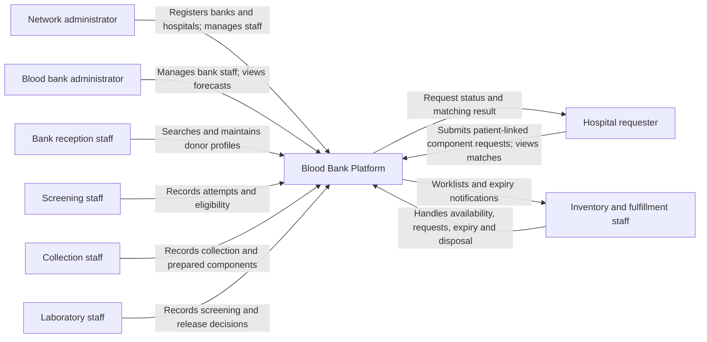
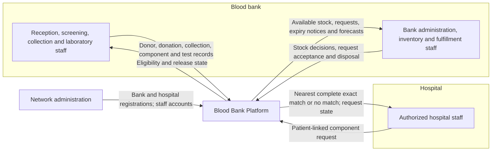
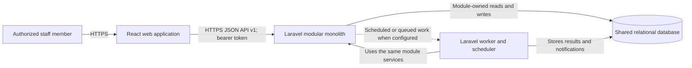
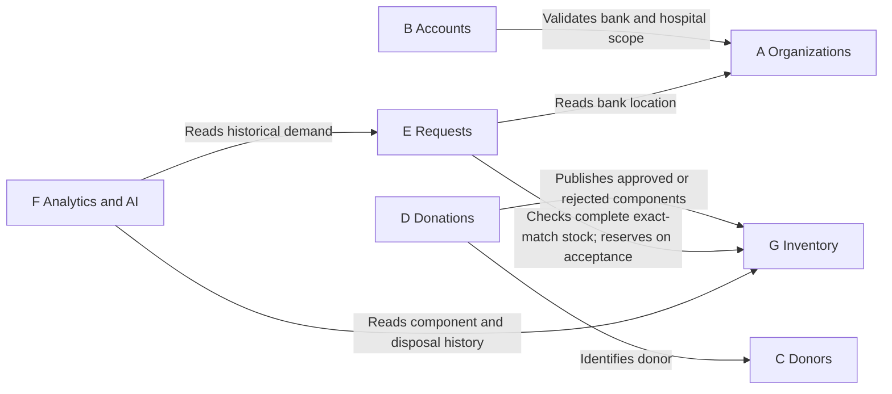

# Blood Bank Platform Architecture

## Purpose and scope

This document describes the intended architecture of the Blood Bank Platform and the current implementation boundary. The platform connects blood banks and hospitals through staff workflows for donor registration, donation, laboratory release, component inventory, hospital requests, and demand forecasting. A React application is the user interface. A Laravel modular monolith owns the business rules and exposes a versioned HTTP API. The seven business modules below own FR-01 through FR-25.

**Diagram convention:** The diagrams show the intended complete platform. They are architectural context, not a claim that every workflow is implemented. The implementation status section identifies what exists today.

## 1. Context diagrams

### 1.1 System context

The platform is one system from the perspective of its users. Each person works through the same web application, while authorization limits the actions available to their role and organization. A blood bank and a hospital are organizations represented in the platform, not separate software systems. The donor is a subject of records; the supplied requirements assign donor profile entry to reception staff rather than to a donor portal.

### 1.2 Organizational and information context

This view adapts the actor-to-system pattern in the supplied examples to the stated requirements. It shows the major information exchanges without implying an automatic interface to a hospital record system, laboratory instrument, messaging provider, or AI vendor; none is specified as a required external integration.

### 1.3 Container context

The browser runs React and sends JSON requests to Laravel. Laravel is a **single deployable backend application** containing the business modules. Its data is stored in a shared database, with ownership enforced in code and schema conventions rather than by separate databases. Background processing may be used for scheduled expiry checks and forecast generation; it remains part of the Laravel deployment. The database engine, queue driver, hosting topology, and any external forecasting provider are deployment decisions, not fixed by these requirements.

## 2. Architectural style and boundaries

- **React frontend:** Presents role-specific screens, sends API requests, validates input for usability, and displays server responses. Navigation visibility is not an authorization decision. It does not own operational records or matching logic.
- **Laravel API:** Authenticates users, checks active status and role/organization scope, validates requests, runs use cases, and returns consistent JSON responses. The current API prefix is `/v1`.
- **Modular monolith:** Each business capability owns its routes, application logic, domain rules, migrations, and tests inside `backend/Modules/`. Modules run in the same Laravel process and can participate in one database transaction where a workflow requires it.
- **Data ownership:** One module is authoritative for each record and state transition. Other modules obtain information through an explicit contract or application service. Direct cross-module model or table access should be an exceptional, documented dependency rather than the default integration method.
- **Core support:** Shared technical code may live in `Core` only when it has no business owner. It must not become a second place for business rules.

### Business module ownership

The lettered modules are the architectural business boundaries. Some existing Laravel module directories are smaller implementation slices of these boundaries; the mapping below keeps the FR owner unambiguous.

| Business module | Owned requirements | Responsibility | Current Laravel directories and intended placement |
| --- | --- | --- | --- |
| **A Organizations** | FR-01 register blood bank; FR-02 register hospital | Bank and hospital identity, location and active state | `Organizations` |
| **B Accounts** | FR-03 view staff; FR-04 update staff; FR-05 add staff to bank; FR-06 login; FR-07 register; FR-08 remove staff from bank; FR-09 deactivate staff | Staff identity, credentials, roles, membership, scope and account lifecycle | `Identity` |
| **C Donors** | FR-10 search donor; FR-11 register donor; FR-12 update donor | Donor identity and contact profile | `Donors` |
| **D Donations** | FR-13 register attempt; FR-14 eligibility; FR-15 start collection; FR-16 complete collection; FR-17 prepare components; FR-18 finalize laboratory screening | Donation journey from attempt through collection, component preparation and release decision | `Donations`, with `Screening` as an internal implementation slice of D |
| **E Requests** | FR-19 submit request; FR-20 view match; FR-21 accept request | Patient-linked hospital request, complete exact-match selection and acceptance workflow | `HospitalRequests`, with `Recommendations` as an internal matching slice of E |
| **F Analytics and AI** | FR-22 generate demand forecast; FR-23 view saved forecast | Demand aggregation, forecast generation and saved forecast versions | `Forecasting`; `Reports` may expose read-only operational views, but owns no listed FR |
| **G Inventory** | FR-24 receive expiry notification; FR-25 record disposal | Released component availability, expiry, reservation, fulfillment and disposal state | `Inventory` |

`Traceability` is a supporting read and audit capability across the donation-to-request chain; it does not take ownership of any FR in this allocation. The physical component is introduced by D at FR-17. G becomes authoritative for its stock availability and disposal after the laboratory release decision. These boundaries should be reflected in APIs and ownership of state transitions even if implementation uses several module directories.

### Module interaction view

Arrows mean a consumer requests information or an action from the owner. They are proposed dependencies, not evidence of implemented service calls.

The Accounts module supplies authentication and authorization to every API route; that platform-wide concern is omitted from the interaction view to keep business dependencies readable.

## 3. Main workflows and state ownership

### Donor to available component

1. Reception searches for an existing donor before creating or updating a profile (C: FR-10–12).
2. Screening staff register a donation attempt and record an eligibility decision (D: FR-13–14). Only an eligible attempt can enter collection.
3. Collection staff record the start and successful completion of collection, including time and volume (D: FR-15–16).
4. A technician records each prepared component container and its own volume (D: FR-17). Component identity must remain traceable to the originating donation.
5. Authorized laboratory staff record screening results and approve or reject the donation (D: FR-18). Only approved components become available to fulfill requests in G. Rejected or unapproved components must never be represented as available stock.

### Hospital request to acceptance

1. Hospital staff submit a patient-linked request for a specific component and quantity (E: FR-19). Access is restricted to their hospital.
2. Matching checks approved, undisposed, unexpired, available stock at candidate banks (G) and selects the nearest bank that can supply the **entire exact-match quantity** (E: FR-20). If no bank can satisfy all requested units, the result is no match. The request does not imply a partial allocation.
3. Authorized inventory or fulfillment staff accept a pending request against still-available components (E: FR-21). Acceptance and reservation must be atomic so two requests cannot claim the same units. The match shown earlier is advisory until this transaction succeeds.

### Expiry, disposal and forecasting

- G detects components whose expiry makes them unusable and creates a notice identifying the specific bank components (FR-24). Inventory staff record actual physical disposal, the responsible person and disposal time (FR-25). An expiry notice is not itself a disposal record.
- F aggregates historical request demand by component and ABO/Rh group to generate a forecast (FR-22), and stores enough provenance to retrieve the same result later (FR-23). A forecast is decision support; it does not change inventory or fulfill a request.

## 4. Cross-cutting rules

**Authorization and privacy.** Laravel enforces role permissions and bank/hospital scope on every protected operation. Staff credentials and bearer tokens are sensitive. Patient-linked requests and donor profiles should expose only the fields required for a user's task. React may hide unavailable actions but cannot grant access. Deactivated users must lose access while historical actions remain attributable to them.

**Consistency and traceability.** Preserve links from donor to attempt, collection, prepared component, laboratory decision, inventory state and request allocation. Record actor and timestamp for consequential state changes. Use transactions for acceptance/reservation and other transitions that update more than one authoritative record. Validate current state at write time; a stale screen must not bypass a newer release, expiry, reservation or disposal decision.

**Performance and scale.** Keep searches and stock queries indexed by the fields they filter and sort on, including bank, component, blood group, status and expiry. Paginate staff and donor lists. Keep matching deterministic and make its eligibility filters explicit. Run long forecast calculations outside an interactive request when needed, while storing their results for FR-23.

**Failure behavior.** Return a clear validation or permission error for rejected actions. If stock changes between viewing a match and accepting a request, re-evaluate availability and return a conflict or a new no-match result rather than silently allocating different or incomplete stock. A failed forecast should leave historical requests and stock unchanged.

## 5. Current implementation and decisions still needed

As of this document, the repository contains a React/Vite login and role-based workspace shell, with operational destinations described as placeholders in the frontend README. The Laravel application has module scaffolds for the business areas. `Identity` implements session and staff-management API routes; `Organizations` has bank and hospital models and migrations but no registration API routes yet. The remaining operational module API route files are placeholders. Therefore the diagrams and workflows above describe the intended architecture, not completed functionality.

The requirements state **FR-07 “Users can register”**, while the current application creates staff through an administrator and has no public registration screen. The product owner must define who may register, whether approval is required, and how a new account receives an organization and role before FR-07 is implemented. Until then, the architecture assumes staff access is provisioned by authorized administrators and does not treat self-registration as an available route.

The supplied requirements also do not select a deployment topology, database engine, forecast algorithm/provider, notification channel, or detailed blood-component compatibility policy. Their interfaces and safety rules should be specified before implementation. In particular, FR-20 says **complete exact match**; broader compatibility or substitution must not be introduced without an explicit requirement change.

## Source of truth

- `docs/BloodBank_Functional_Requirements.docx` defines FR-01 through FR-25 and their priorities.
- The supplied reference images inform the context-diagram presentation and the separation of presentation, control and data concerns. Their actors and labels are illustrative, while this document's actor list and module ownership follow the project requirements.
- `backend/Modules/`, `backend/Modules/Identity/routes/api.php`, and the frontend README establish the implementation status described above.
